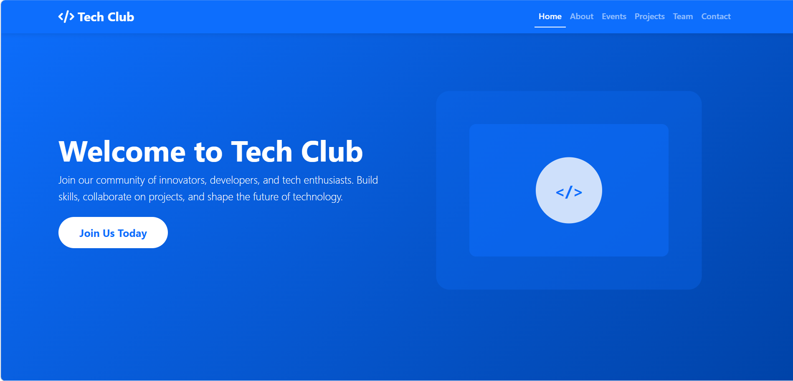

<div align="center">

# ⚡ Byte Society

### College Tech Club Website

A modern, responsive website concept for a college technology club — designed to bring students together through technology, innovation, events, and collaboration.

<br>


<br><br>

**Explore · Learn · Build · Innovate**

</div>

---

## 📌 Overview

**Byte Society** is a responsive website concept for a college technology club, created to showcase club activities, technical events, projects, team members, announcements, and student engagement opportunities.

The project features two independent website implementations developed with the assistance of different AI coding tools — **Claude** and **Windsurf**.

This approach provides an opportunity to explore different UI design approaches, code structures, customization possibilities, and AI-assisted development workflows while building a practical frontend project.

---

## ✨ Features

- 📱 Responsive layout for different screen sizes
- 🎨 Modern UI with a technology-focused visual design
- 🧭 Navigation bar and structured page sections
- 🚀 Hero section with club introduction
- 📅 Events and workshops showcase
- 🛠️ Projects showcase
- 👥 Team members section
- 📢 Announcements section
- 📩 Contact and registration section
- ⚡ JavaScript-based interactive elements
- 🤖 Two implementations developed using different AI coding tools

---

## 🖥️ Website Sections

| Section | Description |
|---|---|
| **Hero** | Introduces Byte Society and its vision |
| **About** | Overview of the technology club |
| **Events** | Showcase of events and technical workshops |
| **Projects** | Highlight student projects and innovations |
| **Team** | Introduce club members and organizers |
| **Announcements** | Share club updates and information |
| **Contact** | Contact and student engagement section |

---

## 🤖 AI-Assisted Development Experiment

The website was developed in two separate versions using different AI development tools.

| Implementation | Development Tool |
|---|---|
| Version 1 | Claude |
| Version 2 | Windsurf |

AI tools assisted during development with website structure, interface generation, styling, JavaScript functionality, debugging, and design modifications.

The generated implementations were reviewed, tested, and customized throughout the development process.

### Comparison Areas

The two implementations can be explored and compared based on:

- UI design and visual presentation
- Layout structure
- Responsive behavior
- Code organization
- Customization flexibility
- Development workflow
- AI-assisted code generation

> This project explores AI as a development assistant while emphasizing the importance of reviewing, understanding, testing, and customizing generated code.

---

## 🛠️ Tech Stack

### Frontend

| Technology | Usage |
|---|---|
| **HTML5** | Page structure and semantic elements |
| **CSS3** | Styling, layouts, and responsive design |
| **JavaScript** | Interactive elements and frontend functionality |
| **Bootstrap 5** | Responsive layout and UI components |
| **Bootstrap Icons** | Interface icons |

### Development Tools

| Tool | Usage |
|---|---|
| **Visual Studio Code** | Development environment |
| **Git** | Version control |
| **GitHub** | Repository management and source code hosting |
| **Claude** | AI-assisted development |
| **Windsurf** | AI-assisted coding and customization |

---

## 📂 Project Structure

```text
byte-society-tech-club/
│
├── Claude/
│   ├── index.html
│   ├── style.css
│   └── script.js
│
├── windsurf/
│   ├── index.html
│   ├── style.css
│   ├── script.js
│   └── README.md
│
└── README.md
```

Each directory contains a separate implementation of the Byte Society website.

---

## 📸 Project Showcase

### Claude Implementation

Website implementation developed with AI assistance using Claude.

<!-- Replace with your actual screenshot path -->


### Windsurf Implementation

Website implementation developed with AI assistance using Windsurf.

<!-- Replace with your actual screenshot path -->


---

## 🚀 Getting Started

Run either implementation locally.

### 1. Clone the Repository

```bash
git clone https://github.com/Naveen25-As/byte-society-tech-club.git
```

### 2. Navigate to the Project Directory

```bash
cd byte-society-tech-club
```

### 3. Run the Website

Choose the implementation you want to explore.

**Claude Version**

Open:

```text
Claude/index.html
```

**Windsurf Version**

Open:

```text
windsurf/index.html
```

You can open the HTML file directly in your browser or use the Live Server extension in Visual Studio Code.

---

## 🎯 Project Objectives

- Build a modern and responsive technology club website.
- Practice HTML, CSS, Bootstrap, and JavaScript.
- Explore different AI-assisted development workflows.
- Compare multiple implementations of the same website concept.
- Understand and customize AI-generated code.
- Practice version control and GitHub project management.
- Develop a practical frontend project for a college tech club.

---

## 📚 Key Learnings

- Responsive web design and layout implementation.
- HTML page structure and organization.
- CSS styling and UI consistency.
- Bootstrap components and responsive layouts.
- JavaScript-based interactions.
- AI-assisted coding workflows.
- Reviewing and modifying AI-generated code.
- Debugging frontend implementations.
- Managing project versions using Git and GitHub.

---

## 🔮 Future Enhancements

- [ ] Implement a functional student registration system.
- [ ] Add backend API integration.
- [ ] Integrate a database for events and registrations.
- [ ] Build an admin dashboard for club management.
- [ ] Implement event registration functionality.
- [ ] Add user authentication.
- [ ] Enable dynamic event and announcement management.
- [ ] Deploy both implementations for public access.

---

## 👨‍💻 Developer

<div align="center">

### Naveen Asundi

**BCA – Artificial Intelligence | Software Development**

Interested in web development, AI-assisted engineering, software development, and building practical applications.

<br>

<a href="https://github.com/Naveen25-As">

</a>

<a href="https://linkedin.com/in/naveen-asundi-0a75b739/">

</a>

</div>

---

<div align="center">

**Designed for students. Inspired by technology. Built through experimentation.**

</div>
